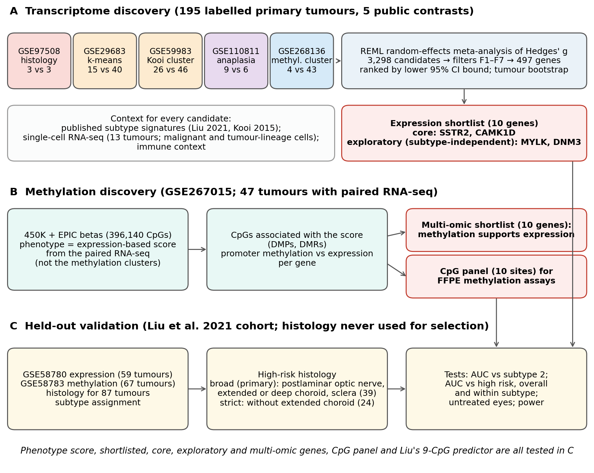
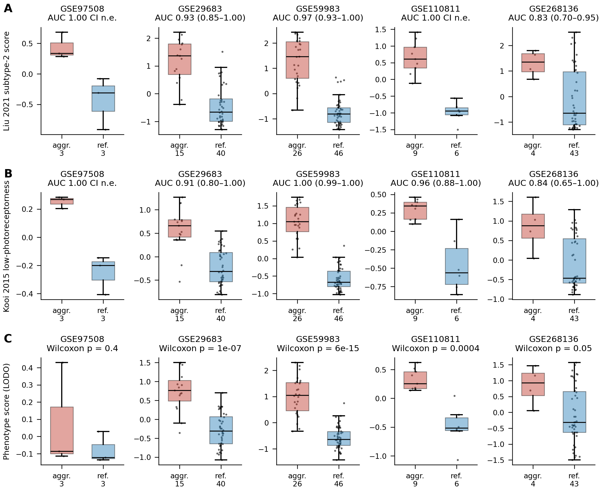
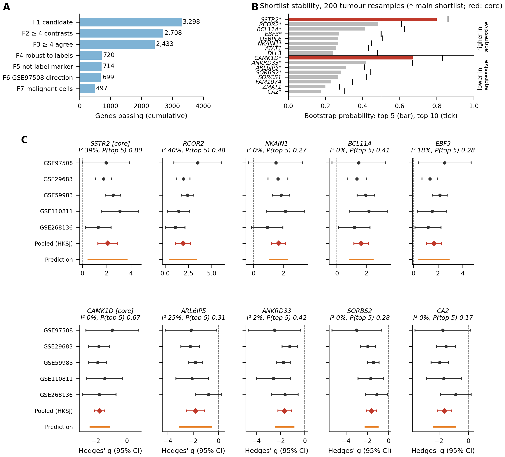
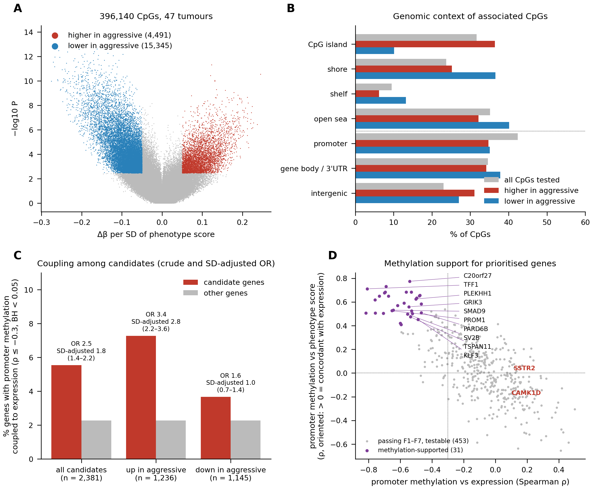
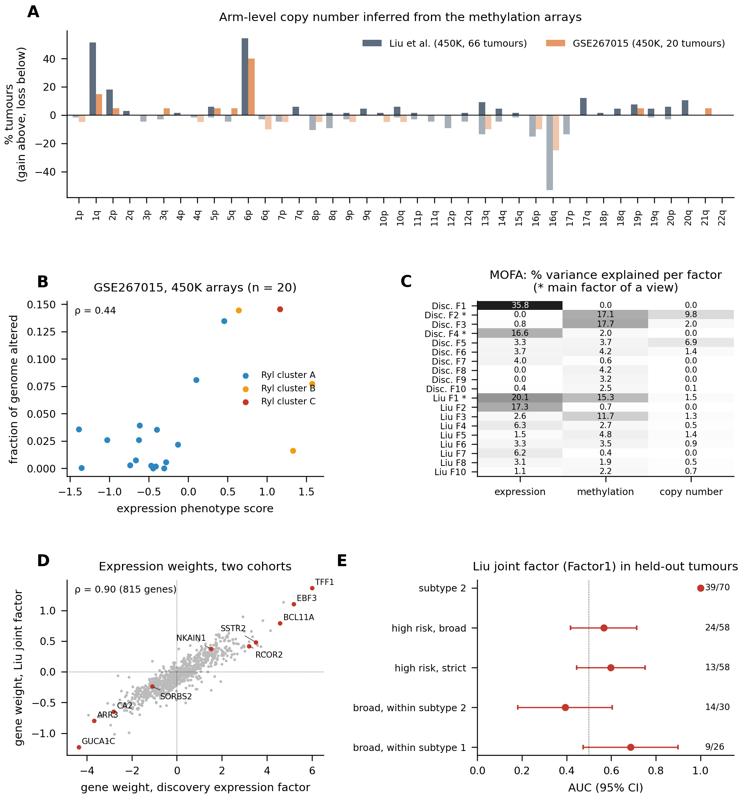
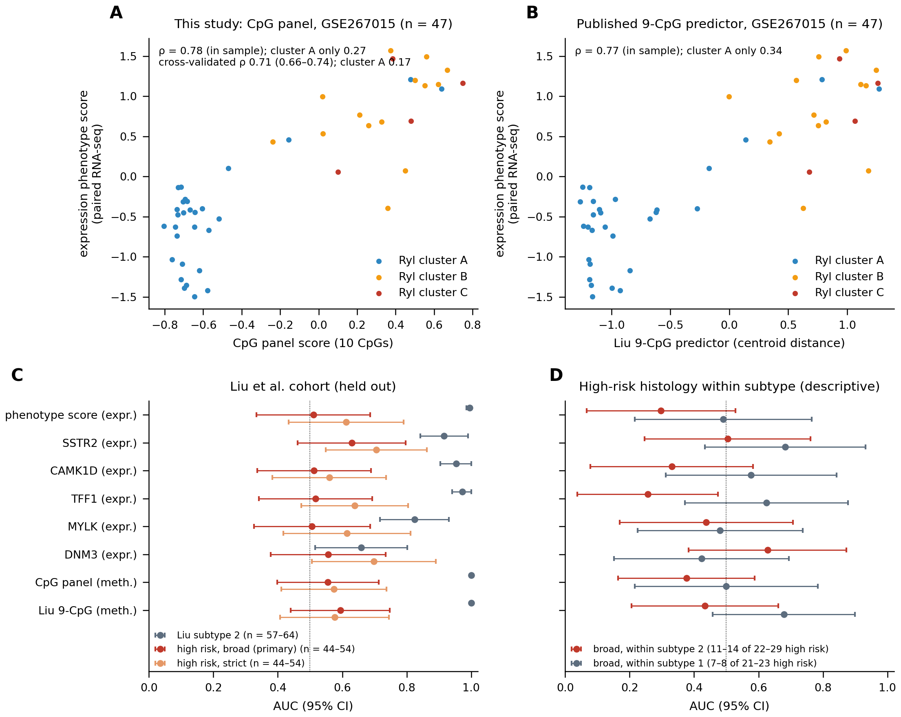
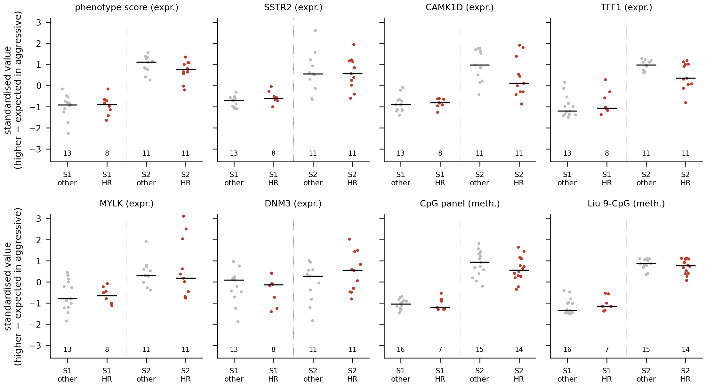

# Multi-omic markers of retinoblastoma de-differentiation and their association with histological high-risk features in a held-out cohort

Analysis code and results for:

> Amiruddin PO, Mazaya M, Arisal A, Irfani I, Kartiwa A, Kartasasmita AS. Multi-omic markers of retinoblastoma de-differentiation and their association with histological high-risk features in a held-out cohort. (Under review.)

A single scripted run (`bash code/run_all.sh`) reproduces every result table of the paper from public data. The results below are from the run of 14 October 2026 (second revision); its log is `logs/run_all.log`.

## Contents

1. [Background and goals](#background-and-goals)
2. [Data](#data)
3. [Study design](#study-design)
4. [Pipeline](#pipeline)
5. [Results](#results)
6. [Genes prioritised for FFPE testing](#genes-prioritised-for-ffpe-testing)
7. [Limitations](#limitations)
8. [Reproducing the analysis](#reproducing-the-analysis)
9. [Repository layout](#repository-layout)
10. [References](#references)
11. [Citation and licence](#citation-and-licence)

## Background and goals

After enucleation for retinoblastoma (RB), adjuvant treatment is guided by histopathological high-risk features: massive choroidal, post-laminar optic nerve, scleral and anterior-segment invasion [1, 2]. No molecular marker of these features has been validated in routinely archived formalin-fixed paraffin-embedded (FFPE) tissue.

Public RB transcriptomes rarely carry histology. Most labels that look like "invasion" are expression clusters, methylation clusters or cytological grades. These all partly measure the same de-differentiation axis that earlier studies described [3–6]. Liu et al. [5] called the de-differentiated, *MYCN*-activated state "subtype 2" and found no difference in histological risk features between subtypes.

The project had three goals:

1. **Prioritise genes.** Use the aggressive phenotypes that public data do record to prioritise genes for FFPE testing, stating what each label measures and testing robustness to its circularity.
2. **Add DNA methylation and copy number.** Find whether the expression differences have methylation and copy-number correlates in the same tumours, whether a small CpG panel could measure the same axis, and whether a joint factor analysis of the three layers recovers it in independent cohorts.
3. **Test against histology.** Test all markers against histological high-risk features, and against subtype, in a cohort whose histology was never used to choose them.

The aim is marker prioritisation and an honest estimate of what public data can and cannot show, not a validated invasion classifier.

## Data

All molecular data are public on GEO. The held-out histology comes from the supplementary tables of Liu et al. [5].

| Accession | Platform | Source | Role in this study | Tumours |
|---|---|---|---|---|
| GSE97508 | Affymetrix PrimeView | Elchuri, Danda et al. (GEO only) | Expression contrast: "invasive" vs "non-invasive" titles (criterion not stated) | 3 vs 3 |
| GSE29683 | Affymetrix HG-U133 Plus 2.0 | McEvoy 2011 [7] | Expression contrast: k-means expression cluster (labelled in this study; circular) | 15 vs 40 |
| GSE59983 | Affymetrix HT HG-U133+ PM | Kooi 2015 [4] | Expression contrast: Ward cluster 1 vs 2 (low vs high photoreceptorness) | 26 vs 46 |
| GSE110811 | Affymetrix HuGene 2.0 ST | Hudson 2018 [8] | Expression contrast: severe vs mild anaplasia | 9 vs 6 |
| GSE268136 | Illumina RNA-seq | Ryl 2024 [6] | Expression contrast: methylation Cluster C vs A+B | 4 vs 43 |
| GSE267015 | Illumina 450K and EPIC (β values and IDATs) | Ryl 2024 [6] | DNA methylation and copy number of the GSE268136 tumours | 51 (47 with paired RNA-seq; 20 with copy number) |
| GSE58780 | Affymetrix HG-U133 Plus 2.0 | Liu 2021 [5] | Held-out validation, expression | 59 (44 with histology) |
| GSE58783 | Illumina 450K (β values and IDATs) | Liu 2021 [5] | Held-out validation, methylation and copy number | 67 (54 with histology); 66 with copy number |
| GSE58784 | BAC array-CGH | Liu 2021 [5] | Independent check of the copy-number calls | 59 shared with GSE58783 |
| GSE249995, GSE168434, GSE166173 | 10x scRNA-seq | Zhang 2025, Wu 2022, Collin 2021 [9–11] | Malignant-cell expression (filter F7) | 13 tumours, 48,854 cells |

The held-out series of Liu et al. was collected mainly at the Institut Curie (Paris), with further tumours from Hospital J.P. Garrahan (Buenos Aires) and Hospital Sant Joan de Déu (Barcelona). All held-out tumours with histology and expression data were from the Institut Curie, as were all but one with histology and methylation data.

Three published supplementary tables are needed in `data/supplementary/`. They must be downloaded by hand from the journals:

| File | Source | Used for |
|---|---|---|
| `41467_2021_25792_MOESM4_ESM.xlsx` | Liu et al. 2021 [5], Supplementary Data 1 | Per-tumour histology, subtype, 9-CpG predictor (step 18) |
| `41467_2021_25792_MOESM6_ESM.xlsx` | Liu et al. 2021 [5], Supplementary Data 3 | Liu subtype-2 signature (step 10) |
| `mmc10.xlsx` | Kooi et al. 2015 [4], gene-cluster supplementary table | Kooi photoreceptorness signature (step 10) |

## Study design



*Fig 1. Study design. (A) Expression discovery in five public contrasts. (B) Methylation discovery in tumours with paired methylation and RNA-seq; copy number from the same arrays; MOFA integration. (C) Held-out validation against histology and subtype.*

**Expression discovery.** Standardised effects (Hedges' g) from limma were combined per gene by random-effects meta-analysis (REML), with Hartung–Knapp–Sidik–Jonkman (HKSJ) intervals and 95% prediction intervals [12–15]. Candidates were genes with BH p < 0.05 for the Wald test and |g| ≥ 0.5. With only five contrasts, this set is not false-discovery-rate controlled under HKSJ. Seven filters were then applied:

- **F1:** candidate.
- **F2:** measured in at least four contrasts.
- **F3:** same sign in at least four contrasts.
- **F4:** robust to removing the expression-labelled cohorts.
- **F5:** not a label-defining gene.
- **F6:** same direction in the only histology-labelled cohort.
- **F7:** expressed in malignant cells of at least three of 13 single-cell tumours.

Genes passing all filters were ranked by the lower 95% confidence bound of |g|, and the top five in each direction formed the shortlist. A 200-resample tumour bootstrap measured how stable the ranking is; "core" genes are those in the top five in at least half of the resamples. Every candidate was also benchmarked against published Liu subtype-2 and Kooi photoreceptorness signatures [4, 5].

**Methylation discovery.** The Ryl methylation clusters were derived from these methylation data, so comparing clusters within them would be circular. The phenotype was therefore an expression phenotype score computed from each tumour's paired RNA-seq, with gene sets taken from the other contrasts only.

- **Associated CpGs and regions:** DMPs (limma on M-values, platform-adjusted) and DMRs (DMRcate) [16–18].
- **Sensitivity analyses:** each array type alone; cell composition estimated from RNA-seq, from the methylation data (EpiDISH) and reference-free (surrogate variables); β recomputed from the IDATs (noob); cluster A alone; adjustment for cluster; a check for the EPIC copy-number artefact.
- **Promoter methylation vs expression:** tested for each candidate gene, with enrichment adjusted for expression variance.
- **CpG panel:** 10 regions, cross-validated with selection repeated inside each fold.

**Copy number and joint factor analysis.** Copy number was inferred from the raw methylation-array intensities with conumee against the CopyNeutralIMA 450K reference [21–24]. EPIC arrays (systematically biased) and arrays with fit noise > 1 were excluded, leaving 20 discovery and 66 Liu tumours. Expression (2,000 genes), methylation (5,000 CpGs) and copy number (39 arms, *MYCN*, *RB1*) were then integrated with MOFA2 [25, 26], without labels, separately in each cohort.

**Held-out validation.** All markers were tested in the Liu et al. cohort:

- **Expression markers:** the phenotype score and the prioritised genes.
- **Methylation markers:** promoter methylation of the same genes, the CpG panel, and the published Liu 9-CpG predictor (a methylation classifier based on nine individual CpG sites, not nine genes).
- **Copy number and joint factor:** fraction of genome altered, arm values (1q, 2p, 6p, 16q), *MYCN*, *RB1*, and the main MOFA factor of the Liu cohort.

High risk was defined two ways. The broad definition (primary) is postlaminar optic nerve, extended (massive) or deep choroidal, or scleral invasion; it corresponds to the IRSWG consensus and the AJCC pT3 category [2, 19]. The strict definition is the same without extended choroidal invasion.

For each marker we report AUCs for subtype and for high risk, within-subtype AUCs, and power computed with the Hanley–McNeil variance [20].

## Pipeline

| Step | Script | What it does | Output |
|---|---|---|---|
| 01 | `01_download_geo.R` | Loads (or downloads) the four microarray cohorts | `results/01_bulk/` |
| 02 | `02_normalize_microarray.R` | Primary tumours only; probe-to-gene collapse; quantile normalisation | `results/01_bulk/` |
| 03 | `03_rnaseq_gse268136.R` | GSE268136 gene matrix; Cluster C vs A+B (limma) | `results/01_bulk/` |
| 04 | `04_invasion_meta_analysis.R` | Per-contrast limma and Hedges' g; REML meta-analysis, HKSJ, prediction intervals, Stouffer. Also run twice with `INVASION_EXCLUDE` for the sensitivity analyses | `results/02_invasion*/` |
| 05 | `05_invasion_signature.R` | Exploratory LASSO classifier (not used for selection) | `results/02_invasion/` |
| 06 | `06_scrna_integration.R` | scRNA-seq QC, Harmony integration, cell types, arm-level CNV malignant calls | `results/03_scrna/` |
| 06b | `06b_copykat_validation.R` | CopyKAT check of the malignant calls | `results/03_scrna/` |
| 07 | `07_scrna_validation.R` | Per-tumour expression in malignant and tumour-lineage cells | `results/02_invasion/`, `results/03_scrna/` |
| 08 | `08_immune_deconvolution.R` | MCP-counter, ESTIMATE; optional CIBERSORTx summary | `results/04_immune/` |
| 09 | `09_invasion_immune.R` | Leave-one-dataset-out phenotype score; immune co-variation | `results/05_invasion_immune/` |
| 10 | `10_subtype_benchmark.R` | Liu subtype-2 and Kooi photoreceptorness scores; subtype-adjusted effects | `results/06_subtype/` |
| 11 | `11_priority_ranking.R` | Filters F1–F7, lower-bound ranking, bootstrap, alternative scenarios | `results/07_priority/` |
| 13 | `13_methylation_preprocess.R` | GSE267015 beta matrix, tumour selection, probe filters, annotation, PCA | `results/08_methylation/` |
| 14 | `14_methylation_phenotype.R` | DMPs and DMRs vs the phenotype score; platform, composition and cluster sensitivity models | `results/08_methylation/` |
| 15 | `15_methylation_expression.R` | Promoter and gene-body methylation vs expression and phenotype score; variance-adjusted enrichment | `results/09_multiomic/` |
| 16 | `16_cpg_marker_panel.R` | 10-CpG panel: ranking, bootstrap, cross-validation (overall and within cluster A) | `results/08_methylation/` |
| 17 | `17_multiomic_priority.R` | Expression + methylation evidence for genes passing F1–F7; methylation-supported shortlist | `results/09_multiomic/` |
| 18 | `18_liu_validation.R` | Held-out cohort: all markers vs high-risk histology (broad, strict, untreated, within subtype) and vs subtype; power | `results/10_liu_validation/` |
| 20 | `20_cnv_from_methylation.R` | Copy number from the methylation IDATs (conumee): arm values, fraction of genome altered, *MYCN*/*RB1*; tests vs phenotype score, subtype and histology | `results/11_cnv/` |
| 22 | `22_cnv_liu_crosscheck.R` | Checks the 450K-derived copy number against Liu et al.'s independent BAC array-CGH of the same tumours (GSE58784) | `results/11_cnv/` |
| 21 | `21_mofa_integration.R` | MOFA2 on expression, methylation and copy number, per cohort; variance explained, factor tests, cross-cohort weights, seed stability; every factor characterised (composition, sex, RNA-quality proxies) | `results/12_mofa/` |
| 23 | `23_methylation_sensitivity_r2.R` | Methylation-based composition (EpiDISH, surrogate variables), noob-recomputed β, EPIC artefact check; effect-size changes | `results/08_methylation/` |
| 24 | `24_within_subtype_exploratory.R` | Exploratory: within-subtype AUCs side by side, subtype-boundary (non-monotonic) tests, composition within subtype 2 | `results/10_liu_validation/` |
| 19 | `19_supporting_info.R` | S1–S14 Tables, package versions, session info (run last) | `results/supporting_info/` |

There is no step 12. `00_scout_methylation_cohorts.R` was a one-off inspection of GSE57362 and GSE58783 and is not part of the pipeline.

## Results

### 1. Public "invasion" labels track the de-differentiation axis



*Fig 2. Liu subtype-2 score (A), Kooi low-photoreceptorness score (B) and the phenotype score (C) by label in each contrast.*

A Liu subtype-2 score built from an independent cohort separated the labels of every contrast:

| Contrast | AUC (95% CI) |
|---|---|
| GSE59983 | 0.97 (0.93–1.00) |
| GSE29683 | 0.93 (0.85–1.00) |
| GSE268136 | 0.83 (0.70–0.95) |
| GSE97508, GSE110811 | 1.00 (complete separation) |

The expression-cluster, anaplasia and methylation labels therefore mark the subtype-2, de-differentiated state. The only histology-labelled cohort (GSE97508, 3 vs 3) cannot separate subtype from residual-retina contamination.

### 2. Expression prioritisation



*Fig 3. Filter cascade (A), bootstrap stability (B) and forest plots of the shortlisted genes (C).*

Of 22,379 genes measured in at least two contrasts, 3,298 were candidates and 497 passed all seven filters. The shortlist and the exploratory tier are below (from Table 2 of the paper; S5 Table has all candidates).

| Gene | Direction in aggressive tumours | Pooled g (95% CI) | P(top 5) | Note |
|---|---|---|---|---|
| *SSTR2* | up | 2.08 (1.51 to 2.65) | 0.80 | core gene; malignant cells in 13 of 13 tumours |
| *CAMK1D* | down | −1.75 (−2.12 to −1.38) | 0.67 | core gene |
| *RCOR2* | up | 1.93 (1.40 to 2.47) | 0.48 | |
| *ANKRD33* | down | −1.66 (−2.06 to −1.26) | 0.42 | |
| *BCL11A* | up | 1.64 (1.24 to 2.04) | 0.41 | |
| *ARL6IP5* | down | −1.81 (−2.31 to −1.32) | 0.31 | |
| *SORBS2* | down | −1.60 (−1.97 to −1.24) | 0.28 | |
| *EBF3* | up | 1.67 (1.19 to 2.16) | 0.28 | |
| *NKAIN1* | up | 1.66 (1.29 to 2.03) | 0.27 | |
| *CA2* | down | −1.63 (−2.02 to −1.23) | 0.17 | |
| *MYLK* | down | −1.52 (−2.00 to −1.05) | 0.09 | exploratory tier: effect kept after subtype adjustment |
| *DNM3* | down | −1.07 (−1.65 to −0.48) | 0.00 | exploratory tier: effect kept after subtype adjustment |

All ten shortlisted genes agreed in sign in all five contrasts, and their HKSJ intervals and prediction intervals excluded zero. After adjustment for the Liu subtype-2 score, however, the candidates' label effects shrank to a median of 25% of their unadjusted size. Only *MYLK* and *DNM3* stayed significant.

### 3. DNA methylation of the same tumours



*Fig 4. CpGs associated with the phenotype score (A), their genomic context (B), coupling of promoter methylation and expression among candidates (C), and methylation support for the prioritised genes (D).*

In 47 paired tumours, 19,836 CpGs were associated with the phenotype score: 4,491 had higher and 15,345 lower methylation in more aggressive tumours. DMRcate found 4,543 regions. More de-differentiated tumours mostly had lower methylation outside CpG islands.

| Sensitivity model | Tumours | Associated CpGs | Main associations reproduced | Effect size vs main |
|---|---|---|---|---|
| 450K arrays only | 20 | 5,232 | 77% | 0.92 |
| EPIC arrays only | 27 | 6,092 | 94% | 1.05 |
| Composition from RNA-seq | 47 | 42,471 | 90% | 1.43 (inflated) |
| Composition from methylation (EpiDISH) | 47 | 5,862 | 72% | 0.75 |
| Surrogate variables (reference-free) | 47 | 4,731 | 71% | 0.61 |
| β recomputed from IDATs (noob) | 47 | 20,456 | 100% | 1.04 |
| Ryl cluster A only | 29 | 4,455 | 73% | 0.61 |
| Adjusted for Ryl cluster | 47 | 1,646 | 67% | 0.73 |

The lower-methylation signal is continuous within a methylation cluster and is not explained by array type or by how β values were processed; the EPIC copy-number artefact did not reach the β values. Composition adjustment based on the methylation data shrank the effects by 25–40% without abolishing them; RNA-based adjustment inflated them (collinear covariates). The smaller higher-methylation signal mainly reflects the difference between clusters.

Promoter methylation was coupled to expression more often for candidate genes than for other genes after adjustment for expression variance (odds ratio 1.78, 95% CI 1.42–2.23). This held only for genes higher in aggressive tumours (2.80; for genes lower in aggressive tumours, 0.96). None of the ten shortlisted genes had methylation support.

The methylation-supported shortlist (Table 4 of the paper) is:

- **higher in aggressive tumours:** *GRIK3*, *TFF1*, *TSPAN11*, *SMAD9*, *C20orf27*;
- **lower in aggressive tumours:** *SV2B*, *PARD6B*, *PLEKHH1*, *KLF3*, *PROM1*.

*TFF1* is a subtype-2 immunohistochemistry marker [5].

The 10-CpG panel tracked the phenotype score in cross-validation (median ρ 0.71). This came mainly from separating cluster A from clusters B/C: within cluster A, the cross-validated ρ was only 0.17. The panel is therefore a subtype classifier, nearly interchangeable with the published Liu 9-CpG predictor (ρ 0.92).

### 4. Copy number and a joint multi-omic factor



*Fig 6. (A) Arm-level gain and loss frequencies from the 450K arrays. (B) Fraction of genome altered vs phenotype score (GSE267015, n = 20). (C) Variance explained by each MOFA factor and view. (D) Gene weights of the main expression factors of the two cohorts. (E) AUCs of the Liu joint factor.*

The 450K arrays showed the recurrent RB changes: in the Liu cohort, 1q gain in 52%, 6p gain in 55%, 2p gain in 18% and 16q loss in 53%. In the 20 discovery tumours, the fraction of genome altered rose with the phenotype score (ρ = 0.44, p = 0.055), as did 1q gain (ρ = 0.48), and 16q loss deepened (ρ = −0.43). In 59 Liu tumours, these calls agreed with Liu et al.'s independent BAC array-CGH (GSE58784): ρ 0.92 for 1q, 0.82 for 2p, 0.93 for 6p, 0.80 for 16q and 0.79 for *MYCN*; the methylation-array calls are conservative (fewer low-level gains).

In the Liu cohort, one MOFA factor was shared by all three layers (20% of expression, 15% of methylation and 1.5% of copy-number variance). It correlated with the phenotype score (ρ = 0.90) and the fraction of genome altered (ρ = 0.63) and separated the subtypes completely (AUC 1.00). Its gene weights agreed with those of the discovery cohort's main expression factor (ρ = 0.90 over 815 genes); *SSTR2*, *EBF3* and *BCL11A* were in the top 5% of weights in both. The de-differentiation axis is therefore a coordinated multi-omic state. The largest other factors measure tumour purity and residual retina (discovery F1: Müller-glia score ρ −0.88). In the first revision a Liu factor was patient sex, because sex-chromosome CpGs had not been filtered; this is corrected.

### 5. Held-out validation against histology and subtype



*Fig 5. CpG panel (A) and Liu 9-CpG predictor (B) against the phenotype score; AUCs in the held-out cohort for subtype and high-risk histology (C) and within subtype (D).*

| Marker | Subtype 2: AUC | High risk, broad: AUC (95% CI) | High risk, strict: AUC (95% CI) |
|---|---|---|---|
| Phenotype score | 0.995 | 0.51 (0.33–0.69) | 0.61 (0.43–0.79) |
| *SSTR2* | 0.92 | 0.63 (0.46–0.80) | 0.71 (0.55–0.86) |
| *CAMK1D* | 0.95 | 0.51 (0.34–0.69) | 0.56 (0.38–0.74) |
| *TFF1* | 0.97 | 0.52 (0.34–0.69) | 0.64 (0.47–0.80) |
| *MYLK* | 0.82 | 0.51 (0.33–0.69) | 0.61 (0.42–0.81) |
| *DNM3* | 0.66 | 0.56 (0.38–0.73) | 0.70 (0.51–0.89) |
| CpG panel | 1.00 | 0.56 (0.40–0.71) | 0.57 (0.41–0.74) |
| Liu 9-CpG predictor | 1.00 | 0.59 (0.44–0.75) | 0.58 (0.41–0.74) |
| Fraction of genome altered | 0.90 | 0.64 (0.49–0.80) | 0.58 (0.40–0.76) |
| MOFA joint factor | 1.00 | 0.57 (0.42–0.72) | 0.60 (0.44–0.75) |

The markers separated the published subtypes almost perfectly but separated high-risk histology poorly. For the broad (primary) definition, AUCs were 0.38–0.64 over all layers, with upper 95% limits up to 0.80; for the strict definition, specified first, 0.29–0.71, with upper limits up to 0.89. No test was significant after correction.

After multiplicity correction, the cohort had about 90% power to detect an AUC of 0.80 but only 28–35% for 0.70. Strong positive associations are therefore unlikely under the broad definition, but moderate associations, strong associations under the strict definition, and inverse associations cannot be excluded.

High-risk features were somewhat more frequent in subtype 2 than in subtype 1 (broad, 51% vs 33%; odds ratio 2.06, 95% CI 0.76–5.81). Within subtypes the markers pointed in opposite directions: higher in high-risk tumours of subtype 1 and lower in those of subtype 2 (29 of 48 markers, against 4 the other way). An exploratory test of the idea that high-risk tumours lie near the subtype boundary gave weak support (*TFF1*, *EBF3*) that did not survive correction; composition did not explain the pattern. An FFPE study should pre-specify a non-monotonic test (S10 Fig below).



*S10 Fig. Held-out marker values by broad high-risk status within subtype (S1, S2).*

## Genes prioritised for FFPE testing

| Priority | Marker | Role | Assay on FFPE tissue |
|---|---|---|---|
| 1 | Liu 9-CpG predictor | Subtype, needed to interpret any histology association | Pyrosequencing |
| 1 | TFF1; ARR3, CRX | Subtype 2 and cone differentiation | Immunohistochemistry |
| 1 | pRB | Identifies *RB1*-wild-type, *MYCN*-amplified tumours | Immunohistochemistry |
| 2 | *DNM3*, *MYLK* | Low-prior hypotheses for a within-subtype effect | RNA (RT-qPCR or NanoString) |
| 3 | *SSTR2*, *CAMK1D* | Most robust markers of the axis; comparators | *SSTR2* immunohistochemistry; *CAMK1D* RNA |
| 4 | *RCOR2*, *BCL11A*, *EBF3*, *ANKRD33*, *SORBS2* | Optional additions to an RNA panel | RNA |

The paper's Table 8 lists the evidence for and against each marker.

## Limitations

Only six of 195 tumours in the discovery contrasts had a histology-based label, and two contrasts used expression-derived labels. Several expression analysis choices were revised after results had been seen; every alternative is reported in S5 Table.

The held-out cohort had 44 tumours with both histology and expression data and 54 with histology and methylation data. Its histology was reported by category. The broad definition was made primary at revision, after the strict results had been seen.

The methylation analysis used submitter-processed β values of two array types (recomputing them from the IDATs gave the same result); composition estimates from RNA-seq and methylation are both collinear with the phenotype score, so the tumour-intrinsic share of the signal is uncertain. The within-subtype analyses were added after the results had been seen and are exploratory. Copy number is relative to tumour purity; the EPIC arrays were excluded for a bias found after the first run, leaving only 20 discovery tumours (4 of them cluster B/C) with copy number. Malignant-cell calls from single-cell data are uncertain, and the CopyKAT cross-check varies between runs (8–11 of 13 tumours separated over five seeds; κ 0.08–0.19). The shortlists do not depend on it.

Copy number and methylation come from the same arrays, so the two layers are not technically independent; against Liu et al.'s array-CGH, the methylation-array calls were accurate but conservative. Exome mutation calls exist for most Liu tumours but were not integrated (median two mutations per tumour, few recurrent genes), and no protein data were available. A search of GEO, ArrayExpress, PRIDE, EGA and PubMed (October 2026) found no other cohort with per-tumour high-risk histology and tumour omics large enough for a test.

## Reproducing the analysis

### Setup (once)

R 4.6.1 from CRAN was used. In R:

```r
install.packages(c("BiocManager", "remotes", "here", "dplyr", "tidyr", "tibble", "purrr", "readr", "ggplot2",
                   "ggpubr", "ggrepel", "circlize", "glmnet", "pROC", "readxl", "openxlsx", "data.table",
                   "Matrix", "Seurat", "harmony"))
BiocManager::install(c("GEOquery", "Biobase", "limma", "preprocessCore", "AnnotationDbi", "org.Hs.eg.db",
                       "ComplexHeatmap", "minfi", "DMRcate", "IlluminaHumanMethylation450kanno.ilmn12.hg19",
                       "conumee", "CopyNeutralIMA", "MOFA2", "EpiDISH", "sva"))
remotes::install_github(c("navinlabcode/copykat", "omnideconv/immunedeconv"))
```

MOFA2 trains through Python: on first use, basilisk builds its own Python environment (a few minutes, no action needed).

The exact versions used are written to `results/supporting_info/package_versions.tsv`.

### Run

From the repository root:

```bash
bash data/download_raw_data.sh   # once; about 12 GB into data/raw/ (incl. methylation IDATs)
bash code/run_all.sh             # about 1 h (final run: 62 min); stops at the first failing step; log in logs/run_all.log
```

Place the three supplementary tables (see [Data](#data)) in `data/supplementary/` before running. The random seed is 42 throughout.

CIBERSORTx is optional and is reported in the Methods only. Step 08 writes mixture files to `results/04_immune/cibersortx_input/`. To include it, run these on https://cibersortx.stanford.edu (LM22, 100 permutations) and save the results as `data/cibersortx/CIBERSORTx_<GSE>.txt`.

## Repository layout

```
code/                  analysis scripts, numbered in run order; run_all.sh runs them all
code/R/                config.R (paths, parameters, high-risk definitions), utils.R, gene_lists.R
data/download_raw_data.sh   fetches all GEO files into data/raw/
data/supplementary/    published supplementary tables (download by hand)
data/cibersortx/       optional CIBERSORTx web-tool results
docs/figures/          main figures of the paper, shown in this README
results/               all result tables (created by the run); results/supporting_info/ = S1–S14 Tables
figures/               diagnostic figures from the R scripts (created by the run)
logs/run_all.log       full log of the run
```

## References

1. Chévez-Barrios P, Eagle RC, Krailo M, et al. Study of unilateral retinoblastoma with and without histopathologic high-risk features and the role of adjuvant chemotherapy: a Children's Oncology Group study. *J Clin Oncol*. 2019;37(31):2883–2891. doi:10.1200/JCO.18.01808
2. Sastre X, Chantada GL, Doz F, et al. Proceedings of the consensus meetings from the International Retinoblastoma Staging Working Group on the pathology guidelines for the examination of enucleated eyes and evaluation of prognostic risk factors in retinoblastoma. *Arch Pathol Lab Med*. 2009;133(8):1199–1202. doi:10.5858/133.8.1199
3. Kapatai G, Brundler MA, Jenkinson H, et al. Gene expression profiling identifies different sub-types of retinoblastoma. *Br J Cancer*. 2013;109:512–525. doi:10.1038/bjc.2013.283
4. Kooi IE, Mol BM, Moll AC, et al. Loss of photoreceptorness and gain of genomic alterations in retinoblastoma reveal tumor progression. *EBioMedicine*. 2015;2(7):660–670. doi:10.1016/j.ebiom.2015.06.022
5. Liu J, Ottaviani D, Sefta M, et al. A high-risk retinoblastoma subtype with stemness features, dedifferentiated cone states and neuronal/ganglion cell gene expression. *Nat Commun*. 2021;12(1):5578. doi:10.1038/s41467-021-25792-0
6. Ryl T, Afanasyeva E, Hartmann T, et al. A MYCN-driven de-differentiation profile identifies a subgroup of aggressive retinoblastoma. *Commun Biol*. 2024;7:919. doi:10.1038/s42003-024-06596-6
7. McEvoy J, Flores-Otero J, Zhang J, et al. Coexpression of normally incompatible developmental pathways in retinoblastoma genesis. *Cancer Cell*. 2011;20(2):260–275. doi:10.1016/j.ccr.2011.07.005
8. Hudson LE, Mendoza P, Hudson WH, et al. Distinct gene expression profiles define anaplastic grade in retinoblastoma. *Am J Pathol*. 2018;188(10):2328–2338. doi:10.1016/j.ajpath.2018.06.013
9. Zhang X, Liu H, Lan Z, et al. Single-cell transcriptomic analyses provide insights into the tumor microenvironment heterogeneity and invasion phenotype in retinoblastoma. *Pathol Res Pract*. 2025;271:156009. doi:10.1016/j.prp.2025.156009
10. Wu C, Yang J, Xiao W, et al. Single-cell characterization of malignant phenotypes and microenvironment alteration in retinoblastoma. *Cell Death Dis*. 2022;13:438. doi:10.1038/s41419-022-04904-8
11. Collin J, Queen R, Zerti D, et al. Dissecting the transcriptional and chromatin accessibility heterogeneity of proliferating cone precursors in human retinoblastoma tumors by single cell sequencing. *Invest Ophthalmol Vis Sci*. 2021;62(6):18. doi:10.1167/iovs.62.6.18
12. Viechtbauer W. Bias and efficiency of meta-analytic variance estimators in the random-effects model. *J Educ Behav Stat*. 2005;30(3):261–293. doi:10.3102/10769986030003261
13. Hartung J, Knapp G. On tests of the overall treatment effect in meta-analysis with normally distributed responses. *Stat Med*. 2001;20(12):1771–1782. doi:10.1002/sim.791
14. IntHout J, Ioannidis JPA, Borm GF. The Hartung-Knapp-Sidik-Jonkman method for random effects meta-analysis is straightforward and considerably outperforms the standard DerSimonian-Laird method. *BMC Med Res Methodol*. 2014;14:25. doi:10.1186/1471-2288-14-25
15. Higgins JPT, Thompson SG, Spiegelhalter DJ. A re-evaluation of random-effects meta-analysis. *J R Stat Soc Ser A*. 2009;172(1):137–159. doi:10.1111/j.1467-985X.2008.00552.x
16. Ritchie ME, Phipson B, Wu D, et al. limma powers differential expression analyses for RNA-sequencing and microarray studies. *Nucleic Acids Res*. 2015;43(7):e47. doi:10.1093/nar/gkv007
17. Du P, Zhang X, Huang CC, et al. Comparison of Beta-value and M-value methods for quantifying methylation levels by microarray analysis. *BMC Bioinformatics*. 2010;11:587. doi:10.1186/1471-2105-11-587
18. Peters TJ, Buckley MJ, Statham AL, et al. De novo identification of differentially methylated regions in the human genome. *Epigenetics Chromatin*. 2015;8:6. doi:10.1186/1756-8935-8-6
19. Mallipatna AC, Gallie BL, Chévez-Barrios P, et al. Retinoblastoma. In: Amin MB, et al., editors. *AJCC Cancer Staging Manual*. 8th ed. New York: Springer; 2017. p. 819–831.
20. Hanley JA, McNeil BJ. The meaning and use of the area under a receiver operating characteristic (ROC) curve. *Radiology*. 1982;143(1):29–36. doi:10.1148/radiology.143.1.7063747
21. Hovestadt V, Zapatka M. conumee: Enhanced copy-number variation analysis using Illumina DNA methylation arrays. R/Bioconductor package. doi:10.18129/B9.bioc.conumee
22. Sturm D, Witt H, Hovestadt V, et al. Hotspot mutations in H3F3A and IDH1 define distinct epigenetic and biological subgroups of glioblastoma. *Cancer Cell*. 2012;22(4):425–437. doi:10.1016/j.ccr.2012.08.024
23. Przybilla M, Pastor X. CopyNeutralIMA: Copy Neutral Illumina Methylation Arrays. R/Bioconductor data package. doi:10.18129/B9.bioc.CopyNeutralIMA
24. Olshen AB, Venkatraman ES, Lucito R, Wigler M. Circular binary segmentation for the analysis of array-based DNA copy number data. *Biostatistics*. 2004;5(4):557–572. doi:10.1093/biostatistics/kxh008
25. Argelaguet R, Velten B, Arnol D, et al. Multi-Omics Factor Analysis—a framework for unsupervised integration of multi-omics data sets. *Mol Syst Biol*. 2018;14(6):e8124. doi:10.15252/msb.20178124
26. Argelaguet R, Arnol D, Bredikhin D, et al. MOFA+: a statistical framework for comprehensive integration of multi-modal single-cell data. *Genome Biol*. 2020;21(1):111. doi:10.1186/s13059-020-02015-1

The full reference list is in the paper.

## Citation and licence

Please cite the paper above and the original publications of the data sets. The code is released under the MIT licence (`LICENSE`).
